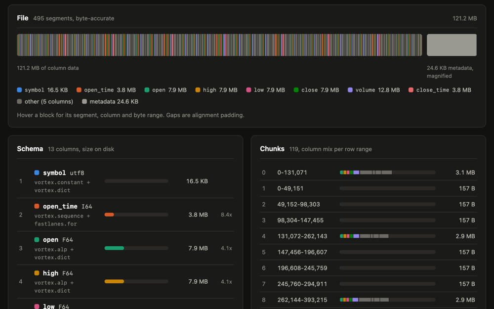

# A Tour of the Vortex Columnar Format with vortex-java

*11 October 2026*

*[Vortex](https://github.com/vortex-data/vortex) is a columnar file format whose compressor picks an encoding per column
and per chunk. It follows the BtrBlocks paper[^btrblocks]: a handful of simple encodings, combined recursively, instead
of one clever encoding. This is a tour for newcomers to Vortex, using the vortex-java library on a public CSV file: what
went in, how it is laid out, and which encoding each column ended up with and why. If you would rather start with
pictures, SpiralDB's [Vortex: One Format for Any Shape](https://spiraldb.com/blog/vortex-one-format-for-any-shape) animates the dictionary,
run-end and bit-packing encodings used below, and how they cascade.*

## The input

[Binance publishes its market data](https://data.binance.vision) as plain files. I took the 1-minute candlesticks
("klines") for 8 pairs (BTC, ETH, BNB, SOL, XRP, ADA, DOGE, LTC against USDT) for all of 2024 and added the pair name as
a first column. The first rows:

```
symbol,open_time,open,high,low,close,volume,close_time,quote_volume,trades,taker_base_volume,taker_quote_volume,ignore
ADAUSDT,1704067200000,0.59390000,0.59410000,0.59320000,0.59400000,104974.20000000,1704067259999,62312.86830000,184,62945.40000000,37368.88100000,0
ADAUSDT,1704067260000,0.59400000,0.59490000,0.59390000,0.59470000,38140.50000000,1704067319999,22675.04514000,87,23698.80000000,14088.40445000,0
ADAUSDT,1704067320000,0.59480000,0.59510000,0.59470000,0.59480000,69129.00000000,1704067379999,41121.03314000,121,47191.90000000,28073.20516000,0
```

Each row is one minute of trading for one pair: the first and last time (`open_time` and `close_time`, in milliseconds
since 1970), the open, high, low and close price, how much was traded, and a few counters. The numbers are written as
fixed-width text (`0.59390000`), part of why a CSV is so wasteful.

4,216,320 rows, 13 columns, 633 MB of CSV. It mixes much of what a real table has: a low-cardinality string, timestamps
in a fixed rhythm, prices with a few decimals, mostly high-entropy volumes, a counter, and a column that is always zero.
Rows are ordered by pair, then time.

To reproduce it:

```bash
for s in BTCUSDT ETHUSDT ...; do for m in 01 ... 12; do
  curl -O https://data.binance.vision/data/spot/monthly/klines/$s/1m/$s-1m-2024-$m.zip
done; done
# unzip, prepend the symbol column and a header line -> eod.csv

java -jar vortex-cli-all.jar import eod.csv eod.vortex
java -jar vortex-cli-all.jar inspect eod.vortex
```

## The result

| | Size | Time |
|---|---|---|
| CSV | 632.9 MB | – |
| CSV + `gzip -6` | 175.6 MB | 13.4 s |
| CSV + `zstd -3` | 187.0 MB | 1.5 s |
| CSV + `zstd -19` | 140.4 MB | 188.8 s |
| **Vortex** | **127.2 MB** | **1.0 s** |

The times are medians of three runs inside one JVM, with JVM start-up and CSV parsing excluded (the Vortex time is
encode and write only). Vortex beat even `zstd -19` by 9% while taking about a second instead of three minutes (189x
faster), and it did so with no general-purpose compression at all: every byte is an encoding that knows something about
the data. The file is also still columnar and random-access, so a reader can fetch one column, or skip chunks by their
min/max statistics, without decompressing the whole thing. A compressed CSV can do neither.

Two caveats on the numbers. The size and timing tables use the library defaults, which write one global dictionary for
`symbol`. The CLI's `import` turns the global dictionary off, so its file is 127.1 MB and `symbol` takes 17 KB instead of
4 KB; the per-column table, the `inspect` report and the screenshot below come from that file. And `inspect` reports
binary megabytes (1 MB = 1,048,576 bytes): the same 127.1 MB file shows up there as 121.2 MB.

With `--compact` the file gets smaller still, to 95.2 MB; see "What `--compact` changes" below.

## How the file is laid out

Each column becomes a stack of layouts:

```
Struct            one child per column
 └ Zoned          min/max/null-count statistics for every 8,192 rows (zone maps)
    └ Chunked     ~1 MiB chunks: 131,072 rows of an 8-byte column, 49,152 of the string
       └ Flat     one encoded segment each
```

The compressor works on one chunk at a time, so one column can use different encodings in different places. That matters
here: a chunk inside one trading pair looks nothing like a chunk that straddles two.

## What each column became

| Column | CSV | Vortex | What it is | Encoding of a typical chunk |
|---|---|---|---|---|
| `symbol` | 34.3 MB | **17 KB** | 8 distinct strings, sorted | `constant` (one pair per chunk); `dict` + `runend` where two pairs meet |
| `open_time` | 59.0 MB | **4.0 MB** | one row per minute | `sequence`: two numbers per chunk |
| `close_time` | 59.0 MB | **4.0 MB** | open_time + 59,999 | `sequence` |
| `open` `high` `low` `close` | 52.7 MB each | **8.3 MB** each | prices, 2 to 8 decimals | `alp` → `for` → `bitpacked` |
| `volume` | 58.3 MB | 13.4 MB | traded amount | `alp` with `patches` |
| `taker_base_volume` | 56.8 MB | 12.9 MB | same family | `alp` |
| `quote_volume`, `taker_quote_volume` | 65.5 / 63.9 MB | 27.1 / 25.7 MB | amount × price, long decimals | `alprd`, or `alp` where it fits |
| `trades` | 16.6 MB | 6.7 MB | trade count | `bitpacked` with `patches` |
| `ignore` | 8.4 MB | **5 KB** | always `0` | `constant` |

A tour of the encodings:

- **`constant`** stores one value for the whole chunk. `ignore` is all zeros, and in a single-pair chunk `symbol` is one
  string; both cost a few bytes per chunk.
- **`dict`** and **`runend`** appear in the `symbol` chunks that are not constant: eight strings stored once, plus small
  codes, run-length encoded because the same pair repeats thousands of times in a row.
- **`sequence`** stores a base and a step. A minute-by-minute timestamp is `base + i × 60000`, so a chunk of 131,072 of
  them is two scalars. The remaining 4 MB is the chunks that cross from one pair to the next (or a gap in the data),
  which are not an exact sequence.
- **`alp`** ("Adaptive Lossless floating-Point"[^alp]) turns decimals back into integers: `0.5939` is stored as `5939`
  plus the exponents that undo it, and values that do not round-trip become "patches". The integers go to the next two
  encodings.
- **`alprd`** ("real doubles") is for floats that are not short decimals, such as `quote_volume`, a product of two
  decimals. It splits each 64-bit value into a few high bits, which repeat and go through a small dictionary, and the
  low bits, which are stored packed. It saves less (55 bits per value instead of 64 in a typical chunk), but it is the
  right tool when ALP cannot help.
- **`for`** (frame of reference) subtracts the chunk minimum so the numbers get small, and **`bitpacked`** stores each in
  as many bits as the largest needs, laid out the FastLanes way[^fastlanes] so a CPU can decode them with SIMD. An
  `open` price takes about 16 bits per row where the CSV spends about 12 characters (96 bits).
- **patches** are the exceptions to a bit width. Bit-packing sizes every value for the largest one in the chunk, so a
  single outlier would widen all 131,072 values. Instead, the few values that do not fit are pulled out into a side list
  of (position, value) pairs, and the rest are packed at the narrower width. This is why `trades` is `bitpacked` with
  `patches`: most minutes have few trades, a rare spike has many. `alp` uses the same mechanism for the values that do
  not round-trip as decimals.


## Encodings that compose

None of these encodings is clever on its own. The savings come from stacking them, the idea Vortex takes from
BtrBlocks[^btrblocks]. For each chunk the compressor tries every candidate encoding on a small sample and keeps the
best. It then treats whatever the winner produces (ALP's integers, a dictionary's codes and values) as a new column and
runs the same competition on it, down to a configurable depth. The Rust crate that does this is `vortex-btrblocks`.

You can read the recursion in the tree that `inspect` prints. For a browsable version, `inspect --html` writes a single
self-contained page (no scripts, no CDN) showing where each column's bytes sit in the file, what share of the file each
column costs, and the per-chunk row ranges, min/max and sizes behind those totals:

```bash
java -jar vortex-cli-all.jar inspect --html eod.vortex > report.html
```

The report for this very file is here: [eod.vortex inspect report](vortex-on-a-real-dataset-inspect.html).

[](vortex-on-a-real-dataset-inspect.html)

One `open` price chunk:

```
alp                    decimals -> integers, plus exponents
 └ for                 subtract the chunk minimum
    └ bitpacked        21 bits per value
```

and a `symbol` chunk where one pair ends and the next begins:

```
dict                   8 distinct strings, stored once
 ├ codes:  runend      the same code repeats thousands of times
 └ values: varbin      the strings themselves
```

Nobody told the compressor any of this: there is no schema hint saying "this column is a timestamp" or "these are
prices". Each decision is a measurement on a sample, and each level only has to be good at one small thing. When you do
know the shape in advance, vortex-java lets you say so per column with `WriteOptions#withColumnEncoding`, restricting the
candidates (for example `ColumnEncoding.candidates(VORTEX_ALP, FASTLANES_FOR, FASTLANES_BITPACKED)` for a fixed-precision
decimal). The library documents this as skipping candidates that cannot win, which is most of a cascading write's cost;
it does not change what the compressor can find. The next section shows what each level is worth.

## How much does the cascade matter?

How many encodings the compressor may stack is the *cascade depth*; `3` is the default. I wrote the same file at each
depth to see what each level is worth:

| Cascade depth | Size | Encode + write |
|---|---|---|
| 0 (no cascade) | 428.1 MB | 0.6 s |
| 1 | 129.8 MB | 1.2 s |
| 2 | 127.2 MB | 1.1 s |
| 3 (default) | 127.2 MB | 1.0 s |

Medians of three runs in one JVM; the three cascading rows are within noise of each other on time. Per column:

| Column | depth 0 | depth 1 | depth 2 and 3 |
|---|---|---|---|
| `symbol` | 8.5 MB | 4 KB | 4 KB |
| `open_time`, `close_time` | 33.7 MB | 4.0 MB | 4.0 MB |
| `open` (and `high`, `low`, `close`) | 34.0 MB | 9.0 MB | 8.3 MB |
| `volume` | 34.1 MB | 13.4 MB | 13.4 MB |
| `trades` | 33.7 MB | 6.7 MB | 6.7 MB |
| `ignore` | 33.7 MB | 5 KB | 5 KB |

What this shows:

- **Depth 0 is the format without the compressor.** Each value takes its full 8 bytes (33.7 MB a column). ALP is chosen
  for the prices, but with nowhere to send its integers the chunk stays raw-sized. It is the baseline: zones and chunks,
  no encodings.
- **Depth 1 does almost all the work.** One encoding per chunk is enough for `sequence`, `constant` and `dict`, so
  timestamps, `symbol` and `ignore` are already final. ALP passing its integers to bit-packing puts the file within
  about 2% of the best (129.8 MB).
- **Depth 2 pays only for prices.** ALP's integers go through frame of reference first, saving two bits per value (23
  down to 21 in a typical chunk): 9.0 MB to 8.3 MB per price column.
- **Depth 3 buys nothing here.** No encoding in this file wants a fourth layer (128 bytes more, no extra time); the deeper
  default leaves room for nested cases, such as a dictionary whose values are floats.

## What `--compact` changes

Vortex has a second preset, *compact* (`--compact` in the CLI, `WriteOptions#withCompact` in the library, the same preset
as Rust's compressor). It adds two encodings to the competition for each chunk: Zstandard for text and
[Pco](https://github.com/pcodec/pcodec), a compressor for numbers. It is off by default.

```bash
java -jar vortex-cli-all.jar import --compact eod.csv eod-compact.vortex
```

| | Size | Encode + write |
|---|---|---|
| Vortex, default | 127.2 MB | 1.2 s |
| Vortex, `--compact` | **95.2 MB** | 1.7 s |

The file is 25% smaller than the default one and 32% smaller than `zstd -19` (140.4 MB), for about 40% more encode time.
Both rows were measured as above (one JVM, median of three runs, parsing excluded). In this run the default took 1.2 s,
not the 1.0 s of the table above; sizes were identical across two JVMs and times within 0.05 s. I did not measure how
fast the compact file is to read.

Per column, against the default file:

| Column | Default | `--compact` | Change |
|---|---|---|---|
| `symbol` | 4 KB | 4 KB | –7% |
| `open_time`, `close_time` | 4.0 MB | 2.0 MB | –51% |
| `open`, `high`, `low`, `close` | 8.3 MB each | 4.3 MB each | –48% |
| `volume` | 13.4 MB | 11.6 MB | –14% |
| `taker_base_volume` | 12.9 MB | 11.0 MB | –15% |
| `quote_volume`, `taker_quote_volume` | 27.1 / 25.7 MB | 23.6 / 22.5 MB | –13% |
| `trades` | 6.7 MB | 5.3 MB | –21% |
| `ignore` | 5 KB | 5 KB | 0% |

The gains are in the columns that ended in `bitpacked`; `ignore`, a `constant`, cannot shrink. The compact file has no
`fastlanes.bitpacked` or `alprd` at all, and `pco` takes their place. For a price, `alp` still produces integers, but
they now go to Pco instead of `for` and `bitpacked`, and the column halves (8.3 MB to 4.3 MB). Bit-packing spends
the same number of bits on every value of a chunk; Pco models the distribution of the values and entropy-codes them.
`open_time` and `close_time` halve as well: the 4 MB that `sequence` could not cover, where one pair ends and the next
begins, falls to 2 MB.

## What can you do with the file?

Smaller is nice, but the file is also queryable without being unpacked first. For the sake of demo, the most convenient way is
[DuckDB](https://duckdb.org), which has a Vortex extension (and actually this is where I heard about Vortex for the first time):

```sql
INSTALL vortex;
LOAD vortex;

-- the closing price of BTC for one hour, 12:00 to 13:00 UTC on 15 June 2024
SELECT open_time, close
FROM read_vortex('eod.vortex')
WHERE symbol = 'BTCUSDT'
  AND open_time >= 1718452800000 AND open_time < 1718456400000
ORDER BY open_time;
```

```
┌───────────────┬──────────┐
│   open_time   │  close   │
│     int64     │  double  │
├───────────────┼──────────┤
│ 1718452800000 │  66328.0 │
│ 1718452860000 │ 66338.39 │
│ 1718452920000 │ 66338.39 │
│      ...      │   ...    │      60 rows in all
│ 1718456340000 │ 66348.01 │
└───────────────┴──────────┘
```

That takes 0.03 s, DuckDB start-up and extension load included. The same query on the CSV, through `read_csv('eod.csv')`,
takes 0.30 s. DuckDB's CSV reader is quick and parallel, so that is a fair baseline, and the Vortex file is still about
ten times faster, from a file one fifth the size.

### Without DuckDB: the CLI

The CLI that ships with vortex-java does the basics. `--timing` on any command prints how long it took, to stderr so a
pipeline still gets only data; the clock starts after the JVM is up, so start-up is not counted. How many rows, and what
range does each column cover?

```
$ java -jar vortex-cli-all.jar count eod.vortex --timing
4216320
elapsed: 33.4 ms
$ java -jar vortex-cli-all.jar stats eod.vortex
column                type                      min              max
symbol                utf8                  ADAUSDT          XRPUSDT
open_time             i64             1704067200000    1735689540000
open                  f64                   0.07434        108258.38
...
```

The row count is stored in the file's layout metadata, so `count` takes 33 ms (60 ms for the whole process) without
reading the data. The fair comparison for a CSV is `wc -l`: 0.44 s for these 633 MB with the file in the page cache,
since it must read every byte to find the newlines (and it says 4216321, because it counts the header).

`select` prints chosen columns, and `--where` (repeatable, all conditions must hold) keeps only some rows. The same
question as above is one command:

```
$ java -jar vortex-cli-all.jar select eod.vortex open_time close \
    --where "symbol = BTCUSDT" --where "open_time >= 1718452800000" --where "open_time < 1718456400000"
open_time,close
1718452800000,66328.0
1718452860000,66338.39
...                                                          # 60 rows
```

With `--timing` it reports about 160 ms (0.18 s for the whole process) and returns the same 60 rows. String values go
unquoted in the expression, and the pair is the selective filter, since the file is sorted by pair and then time.

## Try it on your own data

Pick a CSV you already know well, import it, run `inspect`, and read the per-column encodings. The column whose
encoding surprises you is the one worth investigating.

Everything above was produced by [vortex-java](https://github.com/dfa1/vortex-java), a pure-Java reader and writer for
Vortex. It is checked against the Rust reference in both directions (Rust writes and Java reads, and the reverse), and
against 172 real-world datasets from SpiralDB's [Raincloud](https://github.com/spiraldb/raincloud) corpus, each
matching its Parquet copy value for value (see the
[compatibility notes](https://github.com/dfa1/vortex-java/blob/master/docs/compatibility.md#real-world-conformance-the-raincloud-corpus)).
Real data is where bugs hide, so if you try it on your own files and something decodes wrongly, compresses badly or
just surprises you, please [open an issue](https://github.com/dfa1/vortex-java/issues) with the file's `inspect` output.

---

[^alp]: Azim Afroozeh, Leonardo Kuffó and Peter Boncz, [ALP: Adaptive Lossless floating-Point Compression](https://dl.acm.org/doi/10.1145/3626717), SIGMOD 2024.
[^fastlanes]: Azim Afroozeh and Peter Boncz, [The FastLanes Compression Layout](https://www.vldb.org/pvldb/vol16/p2132-afroozeh.pdf), VLDB 2023.
[^btrblocks]: Maximilian Kuschewski, David Sauerwein, Adnan Alhomssi and Viktor Leis, [BtrBlocks: Efficient Columnar Compression for Data Lakes](https://dl.acm.org/doi/10.1145/3589263), SIGMOD 2023.
